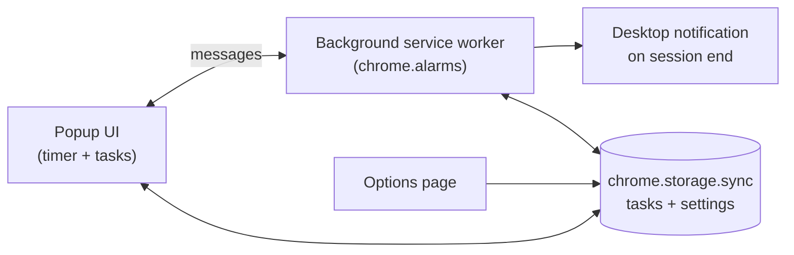

# ZenFocus Browser Extension

> A distraction-free Pomodoro timer with a built-in task manager — MV3, no backend, your tasks and settings synced via the browser.

[](LICENSE)
[](https://github.com/chirag127/zenfocus-bs-ext/stargazers)
[](https://github.com/chirag127/zenfocus-bs-ext/commits)
[](https://developer.chrome.com/docs/extensions/mv3/intro/)
[](https://github.com/chirag127/zenfocus-bs-ext/releases/latest)
[](https://chirag127.github.io/zenfocus-bs-ext/)

Pomodoro timer + task manager browser extension. MV3, Chrome/Edge/Firefox.
No backend — everything runs locally and syncs through `chrome.storage`.

**Links:** [Repo](https://github.com/chirag127/zenfocus-bs-ext) · [Landing page](https://chirag127.github.io/zenfocus-bs-ext/) · [Latest release](https://github.com/chirag127/zenfocus-bs-ext/releases/latest)

⭐ **If this is useful, please [star the repo](https://github.com/chirag127/zenfocus-bs-ext/stargazers)** — it helps others find it.

## Architecture



## Install

**From release (recommended):**
1. Download `zenfocus.zip` from [Latest Release](https://github.com/chirag127/zenfocus-bs-ext/releases/latest)
2. Extract the zip
3. Open `chrome://extensions/` and enable Developer Mode
4. Click "Load unpacked" and select the extracted `extension/` folder

**From source:**
```bash
git clone https://github.com/chirag127/zenfocus-bs-ext.git
# Load the extension/ folder as an unpacked extension
```

## Features

- Pomodoro timer with configurable duration (default 25 min)
- Desktop notification when session ends
- Task list with add/edit/delete (synced via `chrome.storage.sync`)
- Options page to customize timer
- No backend — all data stored locally

## Tech stack

- **Manifest V3** browser extension (Chrome / Edge / Firefox)
- Vanilla **JavaScript**, HTML, CSS — no build step, no framework
- `chrome.alarms` for timing; `chrome.storage.sync` for persistence
- `chrome.notifications` for session-end alerts

## Project Structure

```
extension/          <- Load this folder as unpacked extension
  manifest.json
  background.js     <- Service worker (timer logic, alarms)
  icons/icon.png
  popup/            <- Main UI (timer + tasks)
  options/          <- Settings page
docs/               <- GH Pages landing
```

## Configuration

No environment variables and no secrets — the extension has no
backend. User settings and tasks live in `chrome.storage.sync`.

## Part of the oriz family

One of ~80 [oriz](https://blog.oriz.in) projects — small, sharp,
open-source tools.

## Contributing

PRs welcome. Conventional commits are the changelog.

## Status

**Stable.**

## License

MIT © 2026 Chirag Singhal · chirag@oriz.in — see [LICENSE](LICENSE)
